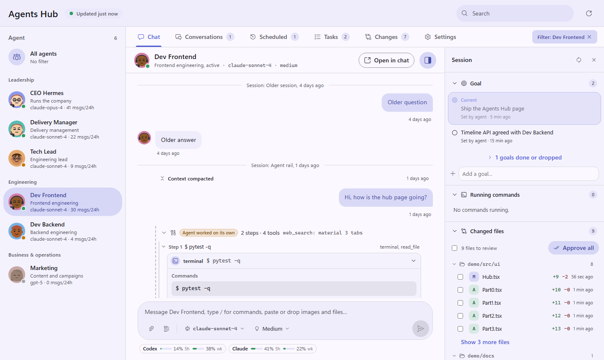
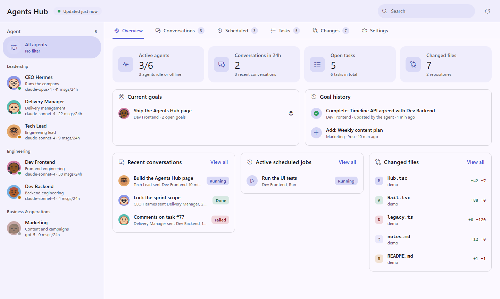
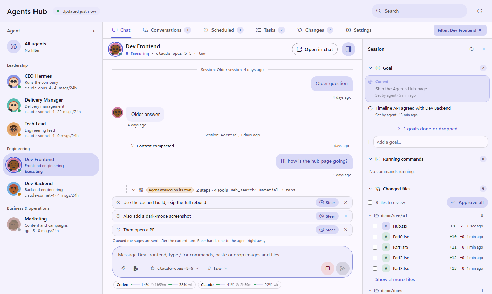
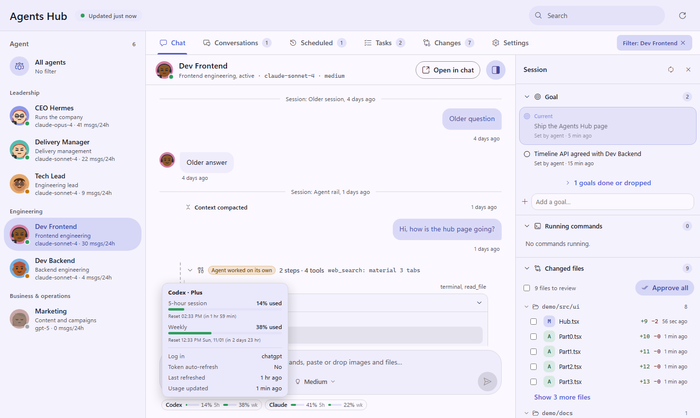
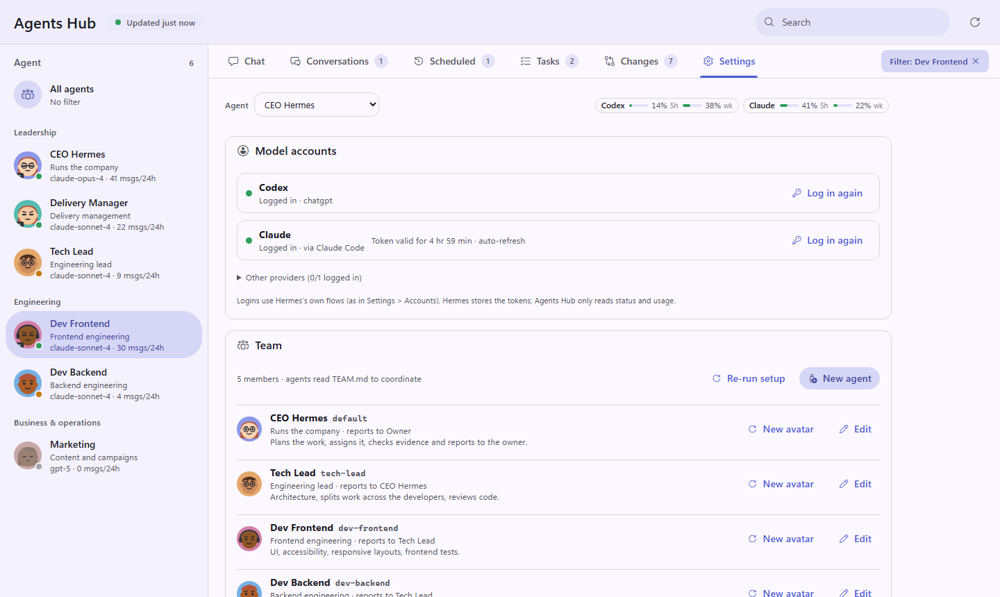
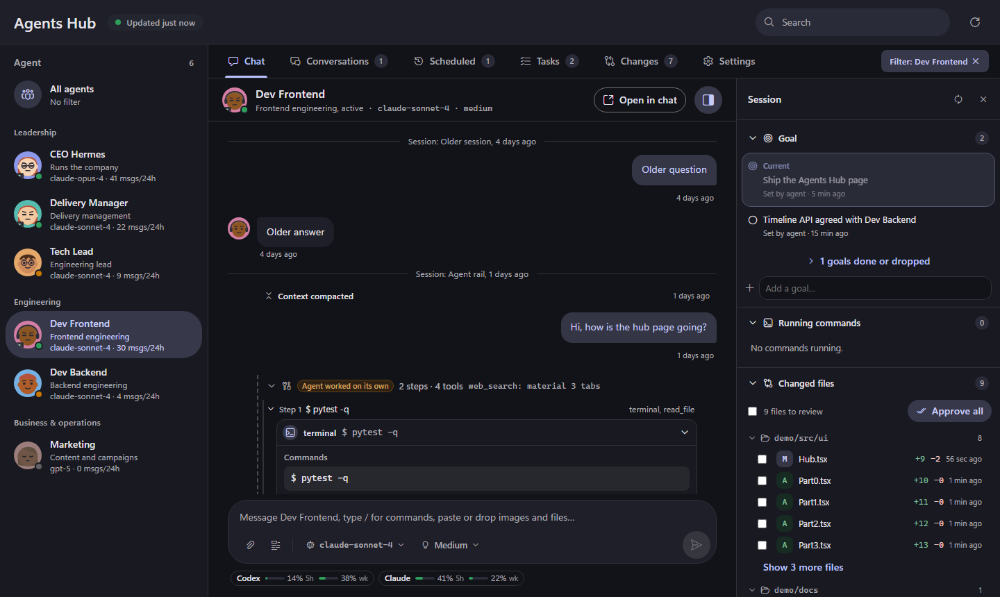

<div align="center">


# Hermes Agent Hub

**One page to chat with, steer and coordinate every agent in your [Hermes Agent](https://github.com/NousResearch/hermes-agent) setup.**

Goals the agents keep up to date · changed files with diff, approve and rollback · permission requests ·
running commands · scheduled jobs · team roster · Claude & Codex usage at a glance.

<p>
  <a href="https://github.com/mynamezxc/hermes-agent-hub/stargazers"></a>
  <a href="https://github.com/mynamezxc/hermes-agent-hub/releases"></a>
  <a href="https://github.com/NousResearch/hermes-agent"></a>
  
  <a href="LICENSE"></a>
</p>

<p>
  <a href="#-install">Install</a> ·
  <a href="#-features">Features</a> ·
  <a href="#-user-guide">User guide</a> ·
  <a href="#-how-agents-learn-the-hub">How agents learn the Hub</a> ·
  <a href="#-data--security">Security</a> ·
  <a href="#-development">Development</a>
</p>



</div>

---

## ✨ Why

Hermes lets you run many profiles: a CEO agent, a tech lead, developers, marketing, support. Each one has its own
sessions, tools and memory. Once there are more than two, it gets hard to see who is doing what, which files changed,
what is waiting for your permission and how much of your Claude or Codex plan is left.

**Agents Hub** puts all of that on one page inside Hermes Desktop, and ships guides that teach every agent how to
work with it: keep goals current, edit files so changes can be reviewed and rolled back, and hand work to the right
teammate.

## 🚀 Install

You need [Hermes Agent](https://hermes-agent.nousresearch.com/docs) with Hermes Desktop.

**Recommended: install through the Hermes plugin catalog.**

```bash
hermes plugins install agents-hub --enable
```

After a terminal install, once:

1. Restart the gateway when no agents are running (Desktop: <kbd>Ctrl</kbd>+<kbd>K</kbd> → **Restart gateway**, or
   `hermes gateway restart`).
2. **Turn on the desktop half.** Hermes Desktop keeps a package's desktop half switched **off** until you enable it
   (`--enable` only enables the agent half). Open **Settings → Plugins** (or **Capabilities → Plugins**), find
   **Agents Hub** and switch on its *Desktop* toggle. Turning the package on from that page switches both halves on.
3. Open **Agents Hub** from the sidebar or press <kbd>Ctrl</kbd>+<kbd>Alt</kbd>+<kbd>H</kbd>.

> **Troubleshooting.** No **Agents Hub** in the sidebar: step 2, then <kbd>Ctrl</kbd>+<kbd>K</kbd> → **Reload desktop
> plugins**. The page says *backend is not loaded* or shows a yellow *restart the gateway* banner: the page was updated
> but the gateway still runs the old backend, so restart the gateway. *Cannot reach the Hermes gateway*: the gateway
> is starting or restarting; the Hub retries by itself.

<details>
<summary>Source install, update, uninstall</summary>

- **Source install (for development or while the catalog listing is unavailable)**: in Hermes Desktop, open
  **Settings → Plugins → Install from Git**, enter `mynamezxc/hermes-agent-hub` and keep the Desktop target checked.
  Or run `hermes plugins install mynamezxc/hermes-agent-hub --enable` and follow the steps above.
- **Update**: `hermes plugins update agents-hub`.
- **Uninstall**: `hermes plugins remove agents-hub`. The Hub's own state in `<HERMES_HOME>/agents-hub/` is left for you to delete.
- **Manual**: copy this repo to `<HERMES_HOME>/plugins/agents-hub/`, add `agents-hub` to `plugins.enabled` in
  `config.yaml`, copy `desktop/plugin.js` to `<HERMES_HOME>/desktop-plugins/agents-hub/plugin.js`, restart the gateway.

</details>

## 🧩 Features

<table>
<tr>
<td width="50%" valign="top">

**Overview of the whole team**<br/>
Active agents, conversations, tasks, changed files, every agent's current goal and the goal history.



</td>
<td width="50%" valign="top">

**Steer an agent while it works**<br/>
Messages typed during a turn are queued. Press **Steer** to hand one to the agent right away, without stopping it,
or remove it. The rest go out when the turn ends.



</td>
</tr>
<tr>
<td width="50%" valign="top">

**Claude & Codex usage under the chat box**<br/>
5-hour and weekly limits as small meters. Hover for the plan, reset times, token expiry and auto-refresh.



</td>
<td width="50%" valign="top">

**Settings: accounts and team**<br/>
Log in to Codex and Claude through Hermes's own flows, edit roles and reporting lines, create agents with a random avatar.



</td>
</tr>
</table>

And also:

- 🙂 **Agent faces with moods**: focused while running tools, thinking, asking for permission, happy when done,
  waiting when idle, asleep when offline. Animated, respects reduced motion.
- 💬 **Full chat**: paste or drop images and files, slash commands, per-session model and reasoning picker, an input that
  grows to 15 lines, older messages load as you scroll up, edit an earlier message and rerun from there.
- 🪜 **Live turns as steps**: "Step N · Working: …" with that step's tools; finished runs fold into one line.
- 🎯 **Goals**: several per agent, one current. Agents add, update and complete them themselves; you can edit too. Agents only file real outcomes (not every chat), and idle goals are flagged.
- 💬 **Conversation switcher**: an agent with several sessions (say one fed by a Facebook trigger and one in Hermes) gets a one-click switcher above the chat; the pick is remembered.
- 🧰 **Saved tools**: apps and dashboards an agent built, listed under Running commands so you can say "open X". The agent adds only substantial tools; you can remove them.
- 📝 **Markdown preview** for `.md` files in the side panel.
- 📝 **Changed files**: per-session diffs, approve all or per file, restore files when you roll back a message.
- 🔐 **Permission requests** inline: allow once, always allow in this goal, always allow, or deny. Every answer is your click; the Hub never approves on its own.
- 🖥️ **Running commands** of every agent: visible vs. background, click to see the command or its live output.
- ⏰ **Scheduled jobs**: create cron jobs through Hermes's own scheduler; see every agent's jobs and runs.
- 🗂️ **Conversations, tasks and git changes**: agent-to-agent transcripts, the Kanban board, repository diffs.
- 🌗 **Light and dark** themes follow Hermes Desktop.

<details>
<summary>Dark theme</summary>



</details>

## 📖 User guide

### 1. Talk to an agent
Pick an agent in the left rail. Type in the box at the bottom: <kbd>Enter</kbd> sends, <kbd>Shift</kbd>+<kbd>Enter</kbd>
adds a line, <kbd>/</kbd> opens commands. Paste screenshots or drop files to attach them. The model and reasoning
level next to the input apply to this agent's chat session.

### 2. Steer while it works
While the agent is running, new messages are **queued** above the input instead of interrupting it.
- **Steer** hands the message to the agent now; it arrives with the next tool result and the agent adjusts course.
- **×** removes a queued message.
- Anything left is sent as a normal message when the turn ends. Messages with attachments are always sent after the turn.
- The stop button ends the turn; the queue then waits for you.

### 3. Goals
The right panel shows the agent's goals. The agent sets and completes them as it works; you can add, edit, mark done,
reopen or delete them. The Overview tab shows every agent's current goal and the full goal history.

### 4. Review changes
**Changed files** lists files the agent wrote in this session, grouped by folder, with a diff on click.
**Approve all** (or tick files and **Approve N**) hides reviewed files until the agent edits them again.
To undo, use ✏️ on one of your earlier messages: the Hub can restore the files to that point and rerun from there.

### 5. Permissions and commands
When an agent wants to run something risky, a card appears in the chat: **Allow**, **Always allow in this goal**
(Hermes remembers it for this chat session), **Always allow** (Hermes's permanent allowlist) or **Deny**. **Running commands** in the right panel lists what every agent is running; the eye icon
marks commands running in the chat, the crossed eye marks background processes (click for live output).

### 6. Scheduled jobs
The **Scheduled** tab lists every agent's cron jobs and runs. **New scheduled job** picks the agent, prompt, frequency
(daily, weekdays, weekly, monthly, hourly, every 15 minutes or a custom cron), delivery target and repeat count.

### 7. Settings: accounts, usage and team
- **Model accounts**: pick an agent to see its Codex and Claude login. **Log in** runs Hermes's flow: Codex shows a
  code and a link; Claude opens an authorize link and you paste the code back. An existing Claude Code login is used too.
- **Claude Desktop / Cowork**: the [connection guide](docs/claude-desktop-connection.md) distinguishes the external file relay, Anthropic model login, and Claude Code CLI.
- **Usage**: the meters under every chat box come from Hermes's read-only usage readers, cached for 10 minutes.
- **Team**: edit each agent's name, role, who it reports to and what it is good at. Agents read this roster
  (`TEAM.md`) to decide who gets which piece of work. **New agent** creates a Hermes profile with a role `SOUL.md`
  and a random face; **New avatar** rolls another face.

### 8. Background automation (opt-in)

Both **Kanban task heartbeat** and **Automatically switch Codex and Claude accounts** are off by default. Enable
them independently in **Hub → Settings → Background automation**. Only an explicit `true` in
`<HERMES_HOME>/agents-hub/settings.json` enables a job (`task_heartbeat` or `auto_switch_accounts`). Once enabled,
the jobs run while the backend is up, even with the Hub page closed. Viewing Workflow or account status does not start them.

| Job | When it checks | Commands it may run |
|---|---|---|
| Kanban task heartbeat | First check after a 30-second startup delay, then every 60 seconds | `hermes kanban promote <task-id> <reason>` for eligible tasks, and `hermes kanban create <title> --assignee … --body … --created-by agents-hub --idempotency-key … --priority …` for English `Answer` and `Review` cards. The check does not call a model; the usual Kanban dispatcher may run the resulting cards. |
| Account auto-switch | First check after a 45-second startup delay, then every 5 minutes when a provider has multiple accounts. Usage at its limit can trigger an earlier check once 60 seconds have elapsed since the last recorded check. | Reads usage without refreshing and runs `hermes auth priority <provider> <id> 0` only when it finds a usable replacement. The Hub does not write Hermes's credential store directly and never runs `hermes auth remove` automatically. |

Turning a job off prevents new writes after the setting is saved. An action already in flight may finish before the change is saved.

Rejected and lapsed logins stay visible in **Model accounts**. Only an explicit, confirmed **Remove** there runs
`hermes auth remove <provider> <credential-id>`. Signing in through the Hub is a separate owner-initiated action:
Claude login invokes `hermes [-p <profile>] auth add anthropic`; a newly approved root login may be made first
priority with `hermes auth priority <provider> <id> 0`. These login actions are independent of periodic auto-switching.

See [Agents Hub improvement proposal](docs/agents-hub-improvement-proposal.md) for project-scoped goals,
task review, and native coding runners.

### 9. Project delivery

In **Workflow → Project delivery**, choose a project from the default Hermes profile. Bind a Kanban board to the
project in Hermes first. The panel shows only cards explicitly linked to that project, even on a shared board.
The existing team workflow and heartbeat are unchanged. The project panel shows task status, milestones, and up to
100 recent Kanban worker attempts for that project.

1. Create one goal for the outcome, with an owner, reviewer and acceptance criteria. Pick a current goal if several
   are open. Use **Draft a Kanban task** for hand-offs, then enter the required task IDs on the goal.
2. Drafts are created **blocked** with an explicit project and board. Verify the assignee, approved workspace,
   sandbox and provider before manually unblocking on that Hermes Kanban board. Codex and Claude selections load
   their respective skills in the assigned Hermes worker, which delegates to the installed CLI if available.
   Gemini sets the model/provider on the Hermes worker; enter only the model ID, never a key. The Hub does not launch
   these CLIs directly or track a separate native CLI session.
3. After a reviewer checks task outputs, record task evidence with **Verify task**. After all required cards are
   verified, **Accept goal** requires separate evidence for the outcome. A reopened/recompleted required card
   invalidates its previous verification. **Archive goal** asks for a reason and confirmation, and keeps history.
4. **Preview legacy goals** lists open per-agent goals without migrating or modifying them. Their original history
   and controls remain in the agent's Goals panel. Rebinding a project pauses edits to its old goal history.

## 🧠 How agents learn the Hub

You do not need to brief your agents. The plugin teaches them:

| Piece | What it does |
|---|---|
| Hidden `<hub-goals>` block | Sent with every Hub message: open goals, the update format, pointers to the skills and the team roster. The Hub strips it from the chat. |
| `agents-hub:hub-operating` | Goals (when to add, complete, drop; evidence before "done"), editing with `write_file` / `patch` so diffs and rollback work, permissions, steering, reply style. |
| `agents-hub:team-coordination` | Read `TEAM.md`, pick members by role and strengths, hand off through Hermes's Kanban board (`kanban_create`), and verify the output. Track hand-offs as tasks, not as separate goals. |
| `agents-hub:hub-setup` | Install, first-run setup, creating agents, accounts and usage. |
| First-run setup | Builds `<HERMES_HOME>/agents-hub/team.json` from each profile's `profile.yaml` and writes `TEAM.md`. Existing `SOUL.md` / `config.yaml` are never touched. |

## 🔒 Data & security

- **Read-only inspection.** Profile databases are opened read-only. Writes to Kanban or account priority via
  automation require the corresponding opt-in above. The Hub can also save its own state and perform explicit owner actions.
- **Tokens stay in Hermes.** Logins run Hermes's own flows; the Hub never returns tokens.
  The pasted Claude code goes straight to the waiting `hermes auth add` process and is never stored or logged.
- **Secret files are excluded.** Returned text is redacted; file previews and diffs exclude `private/`, `*.dpapi`,
  `.env*`, `*token*`, `*secret*`, `*.pem`, `*.key`, `auth.json` and `credentials*`. The Hub gets account IDs via
  Hermes's credential pool API instead of opening `auth.json` itself.
- Extra git repositories for the **Changes** tab: `<HERMES_HOME>/agents-hub.json` with `{"repos": ["/path"]}`, or
  `AGENTS_HUB_EXTRA_REPOS` (path-separator separated).

### What the plugin does on your machine (disclosure)

- **Reads** every profile's `state.db`, `config.yaml`, `profile.yaml`, cron jobs and `processes.json`, plus the shared
  `kanban.db` (read-only), to build the agent list, timelines, goals and running commands.
- **Runs** `git status` / `git diff` in the repositories it shows (list arguments, no shell, with timeouts).
  Auth and Kanban commands and their triggers are listed under [Background automation](#8-background-automation-opt-in).
- **Network**: Hermes makes provider requests for login, usage and opted-in account rotation. Chat usage is cached
  for 10 minutes; the account list uses a separate two-minute cache and supports manual refresh. No telemetry.
- **Writes**: its own state in `<HERMES_HOME>/agents-hub/`, cron jobs and profiles when you create them, Git workspace
  files when you ask to restore them (backed up first), and Kanban/account priority changes when opted in as above.
- **Approvals**: every permission answer is a click by you; the plugin never approves on its own and never starts
  agents in non-interactive (YOLO) mode.
- **Hermes internals**: besides the plugin API it calls a few Hermes modules that are not yet documented plugin
  surfaces (cron creation and delivery targets, profile creation, the dashboard OAuth status routes, the profile
  scope helper). `hermes plugins validate` lists them as warnings; a Hermes update may require a plugin update.

## 🛠 Development

```
plugin.yaml, __init__.py   agent half: registers the skills in skills/
dashboard/                 backend router (plugin_api.py) at /api/plugins/agents-hub
desktop/plugin.js          the Desktop page (plain ESM against @hermes/plugin-sdk)
skills/                    hub-operating, team-coordination, hub-setup
tests/                     backend tests
install.sh, install.ps1    installers
```

Backend tests need a local Hermes install (for the database schemas):

```bash
python -m unittest discover -s tests   # AGENTS_HUB_REAL_HOME / AGENTS_HUB_FIXTURE_DIR override the paths
```

`dashboard/` changes need a gateway restart; `desktop/plugin.js` hot-reloads in Hermes Desktop.

## ⭐ Star history

If Agents Hub saves you time, a star helps other Hermes users find it.

<a href="https://star-history.com/#mynamezxc/hermes-agent-hub&Date">
  
</a>

## 📄 License

[MIT](LICENSE). Agents Hub is a community plugin and is not affiliated with Nous Research.
