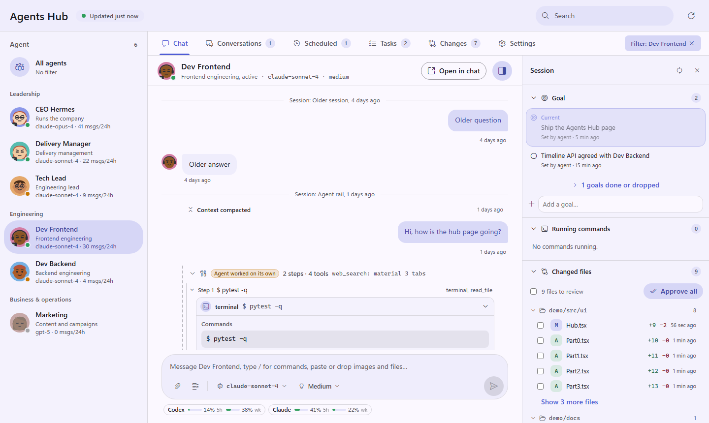
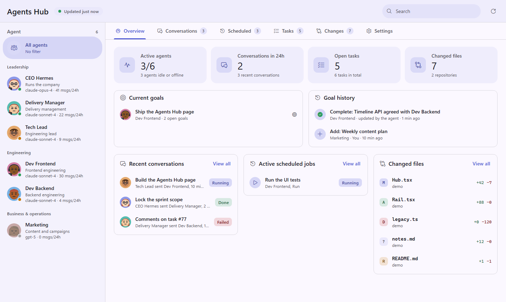
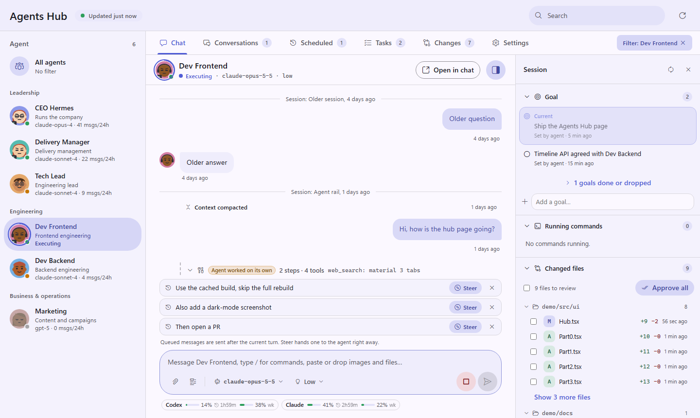
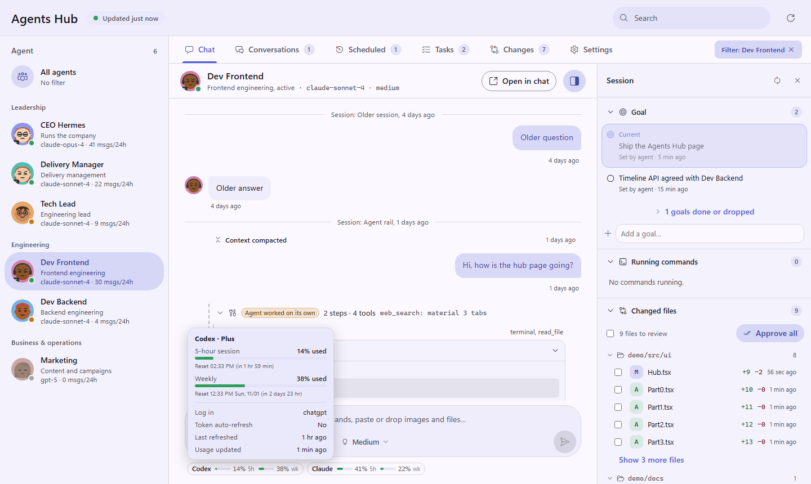
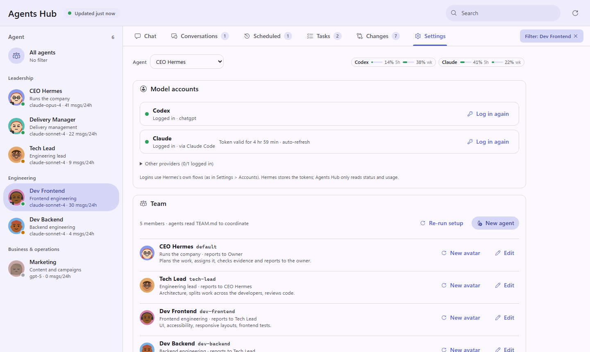
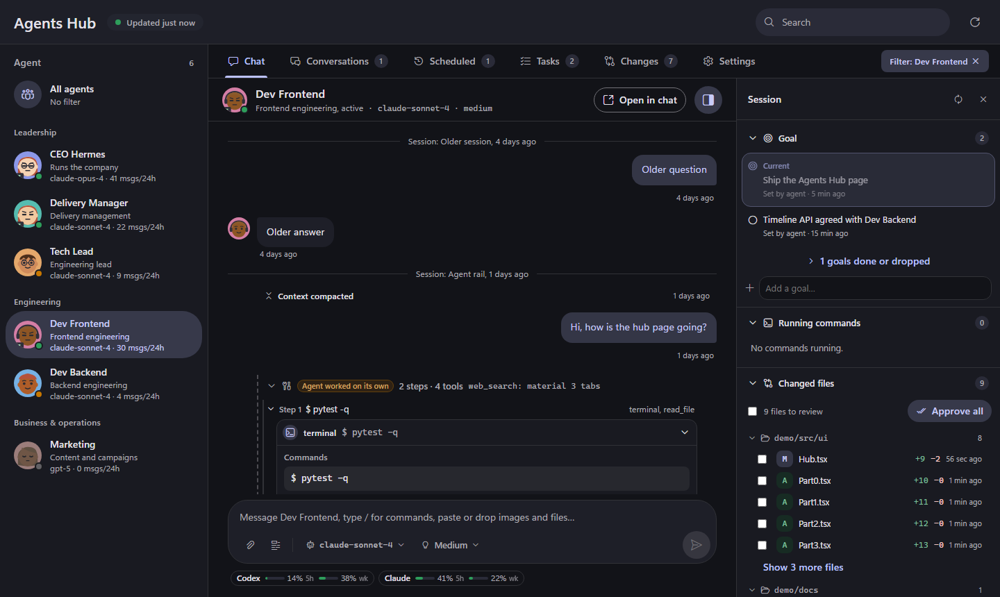

<div align="center">


# Hermes Agent Hub

**One page to chat with, steer and coordinate every agent in your [Hermes Agent](https://github.com/NousResearch/hermes-agent) setup.**

Goals the agents keep up to date · changed files with diff, approve and rollback · permission requests ·
running commands · scheduled jobs · team roster · Claude & Codex usage at a glance.

<p>
  <a href="https://github.com/mynamezxc/hermes-agent-hub/stargazers"></a>
  <a href="https://github.com/mynamezxc/hermes-agent-hub/releases"></a>
  <a href="https://github.com/NousResearch/hermes-agent"></a>
  
  <a href="LICENSE"></a>
</p>

<p>
  <a href="#-install">Install</a> ·
  <a href="#-features">Features</a> ·
  <a href="#-user-guide">User guide</a> ·
  <a href="#-how-agents-learn-the-hub">How agents learn the Hub</a> ·
  <a href="#-data--security">Security</a> ·
  <a href="#-development">Development</a>
</p>



</div>

---

## ✨ Why

Hermes lets you run many profiles: a CEO agent, a tech lead, developers, marketing, support. Each one has its own
sessions, tools and memory. Once there are more than two, it gets hard to see who is doing what, which files changed,
what is waiting for your permission and how much of your Claude or Codex plan is left.

**Agents Hub** puts all of that on one page inside Hermes Desktop, and ships guides that teach every agent how to
work with it: keep goals current, edit files so changes can be reviewed and rolled back, and hand work to the right
teammate.

## 🚀 Install

You need [Hermes Agent](https://hermes-agent.nousresearch.com/docs) with Hermes Desktop.

**Recommended: from Hermes Desktop.** Open the Plugins page (**Settings → Plugins** or **Capabilities → Plugins**),
choose **Install from Git**, enter `mynamezxc/hermes-agent-hub` and keep the *Desktop* target checked. This switches
on both halves of the plugin (the page and its backend) in one go. Then restart the gateway once
(<kbd>Ctrl</kbd>+<kbd>K</kbd> → **Restart gateway**).

**From a terminal.** The installer checks for Hermes, installs or updates the plugin, enables it, verifies the result
and **restarts the gateway** so the backend loads (agents that are running at that moment are interrupted; opt out
with `--no-restart` / `$env:AGENTS_HUB_RESTART='0'`).

**macOS / Linux / WSL / Git Bash**

```bash
curl -fsSL https://raw.githubusercontent.com/mynamezxc/hermes-agent-hub/main/install.sh | bash
```

**Windows (PowerShell)**

```powershell
irm https://raw.githubusercontent.com/mynamezxc/hermes-agent-hub/main/install.ps1 | iex
```

**With the Hermes CLI**

```bash
hermes plugins install mynamezxc/hermes-agent-hub --enable
```

After a terminal install, once:

1. Restart the gateway if the installer did not (Desktop: <kbd>Ctrl</kbd>+<kbd>K</kbd> → **Restart gateway**, or
   `hermes gateway restart`).
2. **Turn on the desktop half.** Hermes Desktop keeps a package's desktop half switched **off** until you enable it
   (`--enable` only enables the agent half). Open **Settings → Plugins** (or **Capabilities → Plugins**), find
   **Agents Hub** and switch on its *Desktop* toggle. Turning the package on from that page switches both halves on.
3. Open **Agents Hub** from the sidebar or press <kbd>Ctrl</kbd>+<kbd>Alt</kbd>+<kbd>H</kbd>.

> **Troubleshooting.** No **Agents Hub** in the sidebar: step 2, then <kbd>Ctrl</kbd>+<kbd>K</kbd> → **Reload desktop
> plugins**. The page says *backend is not loaded* or shows a yellow *restart the gateway* banner: the page was updated
> but the gateway still runs the old backend, so restart the gateway. *Cannot reach the Hermes gateway*: the gateway
> is starting or restarting; the Hub retries by itself.

<details>
<summary>Installer options, update, uninstall, manual install</summary>

| Option | Bash | PowerShell |
|---|---|---|
| Install from a fork or a local checkout | `--repo owner/repo` or `AGENTS_HUB_REPO=…` | `-Repo owner/repo` or `$env:AGENTS_HUB_REPO` |
| Replace a copy that was not installed from git | `--force` | `-Force` or `$env:AGENTS_HUB_FORCE='1'` |
| Do not restart the gateway when done | `--no-restart` or `AGENTS_HUB_RESTART=0` | `-NoRestart` or `$env:AGENTS_HUB_RESTART='0'` |

- **Update**: run the installer again, or `hermes plugins update agents-hub`.
- **Uninstall**: `hermes plugins remove agents-hub`. The Hub's own state in `<HERMES_HOME>/agents-hub/` is left for you to delete.
- **Manual**: copy this repo to `<HERMES_HOME>/plugins/agents-hub/`, add `agents-hub` to `plugins.enabled` in
  `config.yaml`, copy `desktop/plugin.js` to `<HERMES_HOME>/desktop-plugins/agents-hub/plugin.js`, restart the gateway.

</details>

## 🧩 Features

<table>
<tr>
<td width="50%" valign="top">

**Overview of the whole team**<br/>
Active agents, conversations, tasks, changed files, every agent's current goal and the goal history.



</td>
<td width="50%" valign="top">

**Steer an agent while it works**<br/>
Messages typed during a turn are queued. Press **Steer** to hand one to the agent right away, without stopping it,
or remove it. The rest go out when the turn ends.



</td>
</tr>
<tr>
<td width="50%" valign="top">

**Claude & Codex usage under the chat box**<br/>
5-hour and weekly limits as small meters. Hover for the plan, reset times, token expiry and auto-refresh.



</td>
<td width="50%" valign="top">

**Settings: accounts and team**<br/>
Log in to Codex and Claude through Hermes's own flows, edit roles and reporting lines, create agents with a random avatar.



</td>
</tr>
</table>

And also:

- 🙂 **Agent faces with moods**: focused while running tools, thinking, asking for permission, happy when done,
  waiting when idle, asleep when offline. Animated, respects reduced motion.
- 💬 **Full chat**: paste or drop images and files, slash commands, per-session model and reasoning picker, an input that
  grows to 15 lines, older messages load as you scroll up, edit an earlier message and rerun from there.
- 🪜 **Live turns as steps**: "Step N · Working: …" with that step's tools; finished runs fold into one line.
- 🎯 **Goals**: several per agent, one current. Agents add, update and complete them themselves; you can edit too.
- 📝 **Changed files**: per-session diffs, approve all or per file, restore files when you roll back a message.
- 🔐 **Permission requests** inline: allow once, always allow in this goal, always allow, or deny. Every answer is your click; the Hub never approves on its own.
- 🖥️ **Running commands** of every agent: visible vs. background, click to see the command or its live output.
- ⏰ **Scheduled jobs**: create cron jobs through Hermes's own scheduler; see every agent's jobs and runs.
- 🗂️ **Conversations, tasks and git changes**: agent-to-agent transcripts, the Kanban board, repository diffs.
- 🌗 **Light and dark** themes follow Hermes Desktop.

<details>
<summary>Dark theme</summary>



</details>

## 📖 User guide

### 1. Talk to an agent
Pick an agent in the left rail. Type in the box at the bottom: <kbd>Enter</kbd> sends, <kbd>Shift</kbd>+<kbd>Enter</kbd>
adds a line, <kbd>/</kbd> opens commands. Paste screenshots or drop files to attach them. The model and reasoning
level next to the input apply to this agent's chat session.

### 2. Steer while it works
While the agent is running, new messages are **queued** above the input instead of interrupting it.
- **Steer** hands the message to the agent now; it arrives with the next tool result and the agent adjusts course.
- **×** removes a queued message.
- Anything left is sent as a normal message when the turn ends. Messages with attachments are always sent after the turn.
- The stop button ends the turn; the queue then waits for you.

### 3. Goals
The right panel shows the agent's goals. The agent sets and completes them as it works; you can add, edit, mark done,
reopen or delete them. The Overview tab shows every agent's current goal and the full goal history.

### 4. Review changes
**Changed files** lists files the agent wrote in this session, grouped by folder, with a diff on click.
**Approve all** (or tick files and **Approve N**) hides reviewed files until the agent edits them again.
To undo, use ✏️ on one of your earlier messages: the Hub can restore the files to that point and rerun from there.

### 5. Permissions and commands
When an agent wants to run something risky, a card appears in the chat: **Allow**, **Always allow in this goal**
(Hermes remembers it for this chat session), **Always allow** (Hermes's permanent allowlist) or **Deny**. **Running commands** in the right panel lists what every agent is running; the eye icon
marks commands running in the chat, the crossed eye marks background processes (click for live output).

### 6. Scheduled jobs
The **Scheduled** tab lists every agent's cron jobs and runs. **New scheduled job** picks the agent, prompt, frequency
(daily, weekdays, weekly, monthly, hourly, every 15 minutes or a custom cron), delivery target and repeat count.

### 7. Settings: accounts, usage and team
- **Model accounts**: pick an agent to see its Codex and Claude login. **Log in** runs Hermes's flow: Codex shows a
  code and a link; Claude opens an authorize link and you paste the code back. An existing Claude Code login is used too.
- **Usage**: the meters under every chat box come from Hermes's read-only usage readers, cached for 10 minutes.
- **Team**: edit each agent's name, role, who it reports to and what it is good at. Agents read this roster
  (`TEAM.md`) to decide who gets which piece of work. **New agent** creates a Hermes profile with a role `SOUL.md`
  and a random face; **New avatar** rolls another face.

## 🧠 How agents learn the Hub

You do not need to brief your agents. The plugin teaches them:

| Piece | What it does |
|---|---|
| Hidden `<hub-goals>` block | Sent with every Hub message: open goals, the update format, pointers to the skills and the team roster. The Hub strips it from the chat. |
| `agents-hub:hub-operating` | Goals (when to add, complete, drop; evidence before "done"), editing with `write_file` / `patch` so diffs and rollback work, permissions, steering, reply style. |
| `agents-hub:team-coordination` | Read `TEAM.md`, split the work, pick members by role and strengths, hand off through Hermes's Kanban board (`kanban_create`, so the worker runs under its own profile and approvals), track hand-offs as goals, verify, report. |
| `agents-hub:hub-setup` | Install, first-run setup, creating agents, accounts and usage. |
| First-run setup | Builds `<HERMES_HOME>/agents-hub/team.json` from each profile's `profile.yaml` and writes `TEAM.md`. Existing `SOUL.md` / `config.yaml` are never touched. |

## 🔒 Data & security

- **Read-only by default.** Profile databases are opened read-only. The Hub writes only its own state in
  `<HERMES_HOME>/agents-hub/` (team, goals, approvals, setup marker), cron jobs you create (through Hermes's
  scheduler), agents you create, and, when you ask for it, files restored to an earlier message (backed up first).
- **Tokens stay in Hermes.** Logins run Hermes's own flows; the Hub returns status fields and usage percentages only.
  The pasted Claude code goes straight to the waiting `hermes auth add` process and is never stored or logged.
- **Secrets are never shown.** Returned text is redacted; `private/`, `*.dpapi`, `.env*`, `*token*`, `*secret*`,
  `*.pem`, `*.key`, `auth.json` and `credentials*` are never read or diffed.
- Extra git repositories for the **Changes** tab: `<HERMES_HOME>/agents-hub.json` with `{"repos": ["/path"]}`, or
  `AGENTS_HUB_EXTRA_REPOS` (path-separator separated).

### What the plugin does on your machine (disclosure)

- **Reads** every profile's `state.db`, `config.yaml`, `profile.yaml`, cron jobs and `processes.json`, plus the shared
  `kanban.db` (read-only), to build the agent list, timelines, goals and running commands.
- **Runs** `git status` / `git diff` (list arguments, no shell, with timeouts) in the repositories it shows, and,
  only when you press **Log in** for Claude, Hermes's own `hermes [-p <profile>] auth add anthropic`; that process is
  killed after 15 minutes if you never finish.
- **Network**: none of its own. Usage numbers come from Hermes's read-only usage readers, which call Anthropic's and
  OpenAI's usage endpoints with the login Hermes already holds, at most every 10 minutes while the Hub is open.
  No telemetry.
- **Writes**: its own state in `<HERMES_HOME>/agents-hub/`, cron jobs and profiles only when you create them, and files
  only when you ask to restore them to an earlier message (the current content is backed up first).
- **Approvals**: every permission answer is a click by you; the plugin never approves on its own and never starts
  agents in non-interactive (YOLO) mode.
- **Hermes internals**: besides the plugin API it calls a few Hermes modules that are not yet documented plugin
  surfaces (cron creation and delivery targets, profile creation, the dashboard OAuth status routes, the profile
  scope helper). `hermes plugins validate` lists them as warnings; a Hermes update may require a plugin update.

## 🛠 Development

```
plugin.yaml, __init__.py   agent half: registers the skills in skills/
dashboard/                 backend router (plugin_api.py) at /api/plugins/agents-hub
desktop/plugin.js          the Desktop page (plain ESM against @hermes/plugin-sdk)
skills/                    hub-operating, team-coordination, hub-setup
tests/                     backend tests
install.sh, install.ps1    installers
```

Backend tests need a local Hermes install (for the database schemas):

```bash
python -m unittest discover -s tests   # AGENTS_HUB_REAL_HOME / AGENTS_HUB_FIXTURE_DIR override the paths
```

`dashboard/` changes need a gateway restart; `desktop/plugin.js` hot-reloads in Hermes Desktop.

## ⭐ Star history

If Agents Hub saves you time, a star helps other Hermes users find it.

<a href="https://star-history.com/#mynamezxc/hermes-agent-hub&Date">
  
</a>

## 📄 License

[MIT](LICENSE). Agents Hub is a community plugin and is not affiliated with Nous Research.
